# PrintNinja — Mobile usability plan

Branch audited: `develop` @ `739c809` (API server auto-start). Date: 2026-10-24.
Scope: the web build of the app (Vite dev server) at phone widths. No application source was changed; this folder only adds the screenshots and this plan.

## TL;DR

The app is **not** desktop-only on phones. It already switches to a bottom navigation bar below `md` (768px), stacks forms into one column, and `Button`, `Input` and `Select` already grow to 44px on coarse pointers. The remaining problems are concentrated in a few places:

1. **Data tables are not phone-shaped** (Templates, Printers, History): columns get cut off or stacked awkwardly, and row actions are tiny.
2. **The Designer is a long vertical scroll**: you scroll past three accordions to reach the canvas or the code editor, and the canvas preview is unreadably small.
3. **Navigation and tab strips overflow**: seven bottom-nav items with truncated labels, an eight-tab Settings strip that clips with no hint that it scrolls.
4. **The primary action (Print) is buried** under the form, and sync/offline status is invisible on phones.
5. **Phone landscape gets the desktop layout**, and the viewport meta / `100vh` setup will misbehave on notched or URL-bar phones.

At 390px no page overflows the document horizontally (`scrollWidth − innerWidth = 0` on every audited page); overflow happens inside tables and tab strips instead. At 360px only the Printers table was measured, and it does clip. The issues are about fit and ergonomics, not breakage.

## How this was measured (and what it can't tell you)

| | |
|---|---|
| App | `pnpm dev --host 0.0.0.0` → `http://localhost:1420` (Vite, web mode) |
| Browser | Headless Chromium 1243 (preinstalled), Playwright driving it |
| Devices emulated | Pixel-7-style 390×844 @2x touch (main), 360×640 (small), 844×390 (landscape) |
| Data | The repo's own e2e **fake desktop agent** (`e2e/support/fakeAgent`) with 3 seeded templates and 2 printers |
| Audit | Per-page script: document overflow, elements wider than the viewport, interactive elements under 44×44 px |
| Raw data | [`shots/audit.json`](shots/audit.json), [`shots/notes.json`](shots/notes.json) |

Limits you should know about:

- **The real share server was not run.** This sandbox blocks the Prisma engine download, so `prisma generate` and the server build could not complete. The share API (`/v2/...`) was stubbed in the browser with empty lists, so Community/Saved are empty and the Templates tabs show `Mine (3)` only. The sign-in screen is the real one.
- **Fake agent, not Tauri.** Printing, the local REST API and Android-only code (`BackgroundAndroid`) did not run. The Setup checklist even says some steps "can't be checked in the browser preview". Anything touching the Tauri Android WebView (safe areas, keyboard, back button, `tauri.localhost`) needs a check on a real device or emulator.
- Tap-target counts come from computed boxes in a touch-emulated Chromium; they are a guide, not an accessibility certification.
- The Designer's canvas shows seeded placeholder HTML, so real label layouts will look different.

## Priority summary

| # | Issue | Pages | Severity | Effort |
|---|---|---|---|---|
| 1 | Tables overflow/clip and have tiny row actions → card list on phones | Printers, Templates, History | High | M |
| 2 | Print button buried below the form; no sticky action | Print | High | S |
| 3 | Designer: long scroll, tiny canvas, no sticky view tabs | Designer | High | L |
| 4 | History filters: 6 unlabeled stacked controls push results off-screen | History | High | S |
| 5 | Bottom nav: 7 items, truncated labels | All | Medium | S |
| 6 | Settings: 8-tab strip clips with no scroll cue | Settings | Medium | S |
| 7 | Sub-44px tap targets on tabs, sort buttons, header link | Several | Medium | S |
| 8 | Sync/offline status hidden below 640px | All | Medium | S |
| 9 | Landscape phone gets the desktop sidebar layout | All | Medium | S |
| 10 | Viewport meta, `100vh`, safe areas | All | Medium | S |
| 11 | Keyboard shortcut hints shown on touch | Command palette, help | Low | S |

Effort: S ≈ under a day, M ≈ 1–3 days, L ≈ 3+ days (rough, one developer who knows the codebase).

---

## What already works

Keep these as-is; they are the baseline the fixes should match.

<table>
<tr>
<td align="center">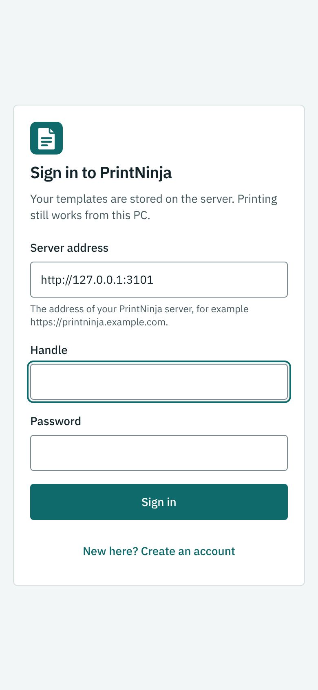 Sign-in: full-width fields, correct <code>inputMode</code>/<code>autoComplete</code></td>
<td align="center">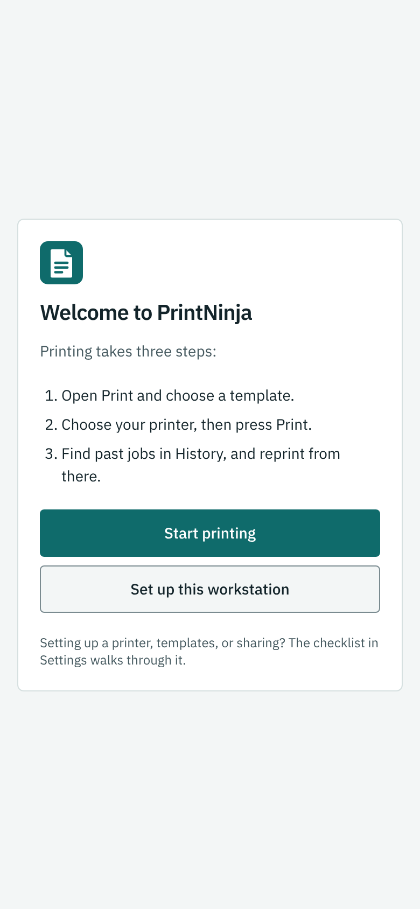 Onboarding: single column, large buttons</td>
<td align="center">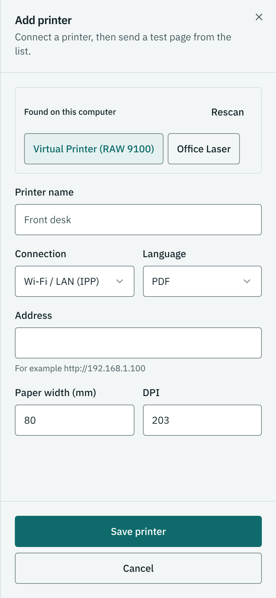 Add printer: full-height sheet, Save/Cancel at the bottom</td>
</tr>
</table>

- Bottom navigation with safe-area padding (`Layout.tsx:406`) and `min-h-14` items.
- `Button`, `Input` and `Select` get `min-h-11` on `pointer: coarse` (`ui/button.tsx:7`, `ui/input.tsx:12`, `ui/select.tsx:19`).
- The Add-printer form is a full-height sheet (`PrinterSetup.tsx:488`) with large fields and full-width Save/Cancel. This is the pattern to reuse for the Designer controls and History filters.
- Settings → General says "Touch screens always use the larger controls", so density is already handled.

---

## Page by page

### 1. Print (`/print`) — the screen people use most

<table>
<tr>
<td align="center">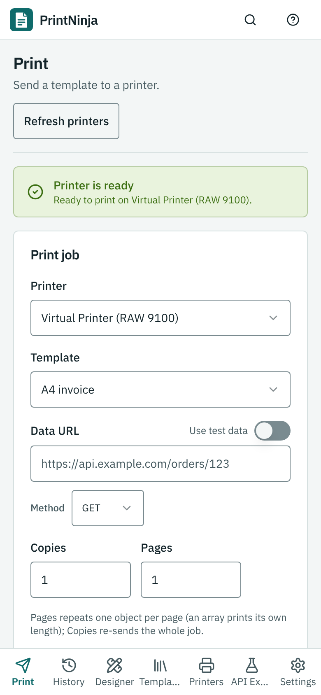 Top of page</td>
<td align="center">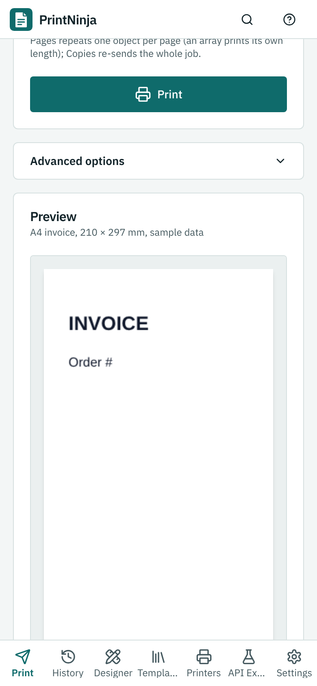 Scrolled 700px</td>
<td align="center">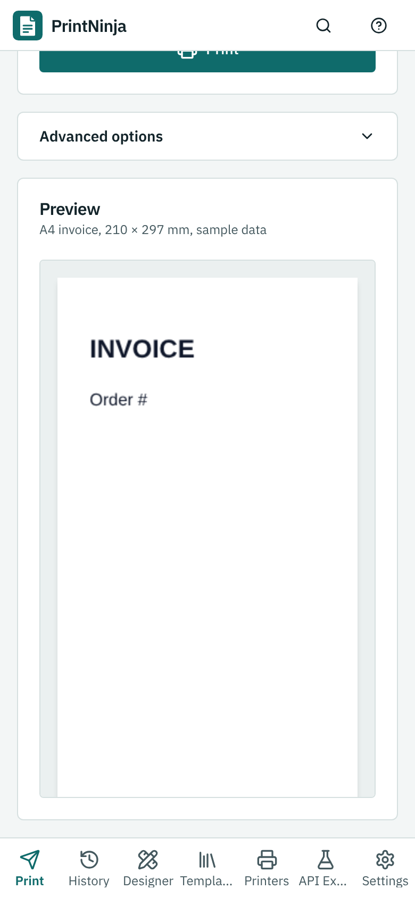 Bottom: Print button is at the very top edge</td>
</tr>
</table>

**Problems**
- The **Print** button sits at the end of the form card. On a 844px-tall phone the page is ~1500px tall (`scrollHeight 1509` vs `clientHeight 739`), so Print is only reachable after scrolling, and it ends up hidden behind the header in the bottom-scrolled screenshot.
- The preview of an A4 template is a full-width panel about 600px tall at the bottom of the page.
- The data section (Data URL, Method, Copies, Pages and the helper text) takes most of the first screen, ahead of anything the operator changes on a repeat job.

**Fixes**
- Add a **sticky action bar** above the bottom nav on `< md`: `[Printer name ▾]  [Print]`. Print state (busy, disabled reason) goes there too.
- Collapse **Data URL / Method / Copies / Pages** into the existing "Advanced options" accordion by default when "Use test data" is on.
- Make the preview collapsible ("Preview ▸") and cap its height (about 40vh) with tap-to-expand.

### 2. Designer (`/template/:id`)

<table>
<tr>
<td align="center">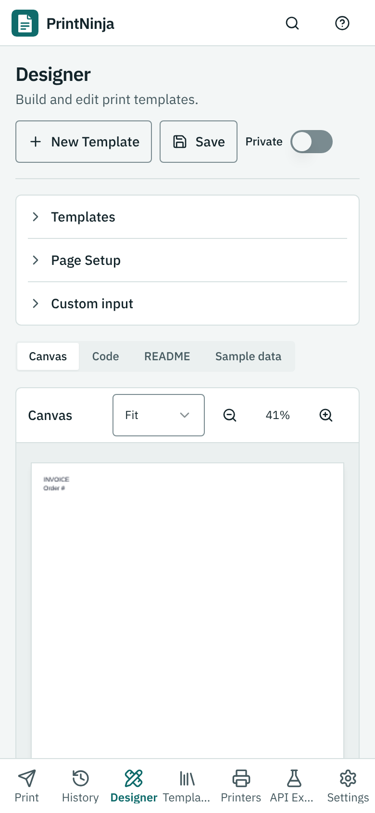 Collapsed controls</td>
<td align="center">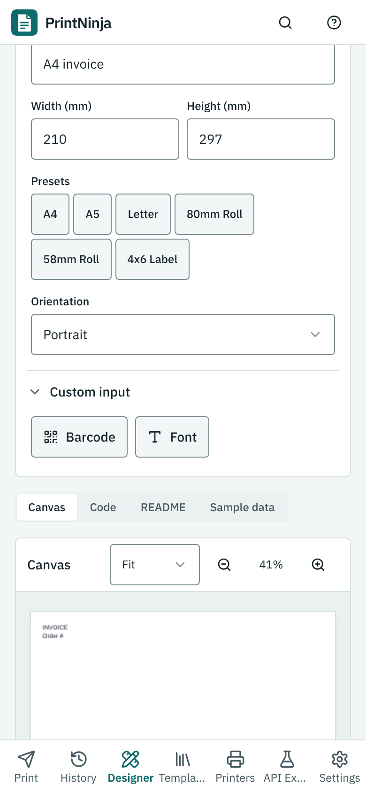 Accordions open: canvas pushed far down</td>
<td align="center">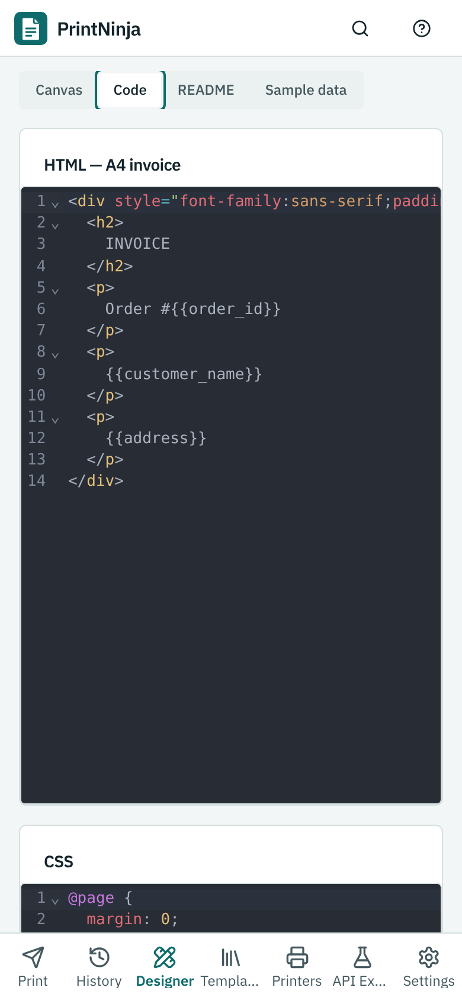 Code tab, after scrolling to the tabs</td>
<td align="center">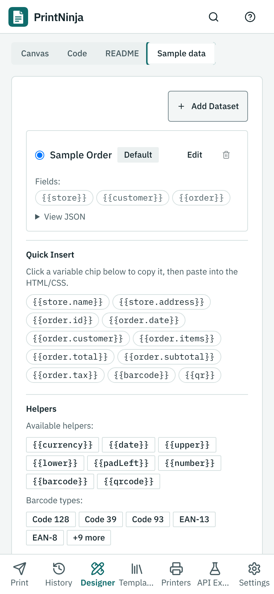 Sample data tab</td>
</tr>
</table>

**Problems**
- With **Templates / Page Setup / Custom input** open, the page grows to about 1,585px against a 739px visible area (measured), so the canvas is far below the first screen. The Canvas / Code / README / Sample data tabs scroll away with the content, so switching views means scrolling up and down.
- The canvas "Fit" zoom is **41%**: the seeded text is about 5px and unreadable. There is no obvious pinch-zoom or tap-to-zoom.
- The HTML code editor is a tall box (about 500px) that is mostly empty, and the code line is clipped on the right (`style="font-family:sans-serif;paddi…`), with horizontal scroll inside a vertical scroll.
- The view tabs are `h-7`/`h-8` with `text-xs` (`Designer.tsx:963–976`), smaller than the 44px target the rest of the app uses.
- Editing HTML/CSS with a phone keyboard is realistically a "tweak" task, not an authoring one.

**Fixes**
- Decide the phone scope explicitly (see Open questions). Recommended: **view and tweak** on phones, full authoring on tablet/desktop.
- Make the **view tabs sticky** under the header and 44px tall.
- Move Templates / Page Setup / Custom input into a **bottom sheet** opened from a single "Settings" button, so the canvas is the first thing on screen.
- Canvas: default to **fit-width**, enable pinch-zoom and double-tap-to-zoom, and show real dimensions ("100 × 150 mm") in the toolbar.
- Code editor: soft-wrap on by default on phones, height `min(60vh, content)`, and a visible "Done" button to dismiss the keyboard.
- Keep Save reachable (sticky header action) so a tweak is two taps from saved.

### 3. Templates (`/templates`)

<table>
<tr>
<td align="center">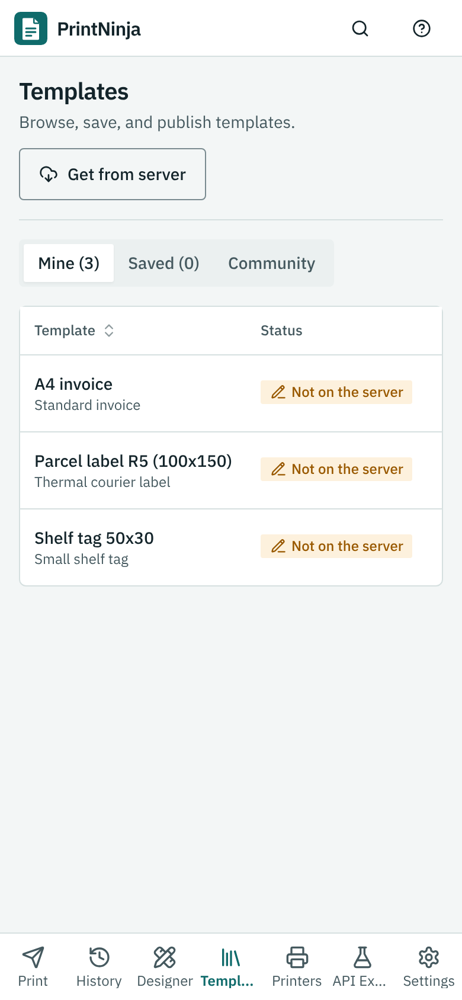 Only Template + Status visible</td>
<td align="center"> Community tab (empty here: server stubbed)</td>
</tr>
</table>

**Problems**
- The table renders **703px wide inside a 358px wrapper** (measured). Columns after Status are off-screen behind a horizontal scroll that nothing signals.
- The Mine / Saved / Community tabs are 32px tall (`Templates.tsx:572`).
- Sorting is a tiny icon beside the column header.
- The "Not on the server" badge takes a whole column for what is secondary information.

**Fixes**
- Render rows as **cards** below `md`: name + summary on line one, status badge and page size on line two, a kebab (⋯) menu for actions. Tapping the card opens it in the Designer.
- Replace header sort with a single "Sort" dropdown above the list.
- Raise the tab triggers to 44px (see cross-cutting).

### 4. Printers (`/printers`)

<table>
<tr>
<td align="center">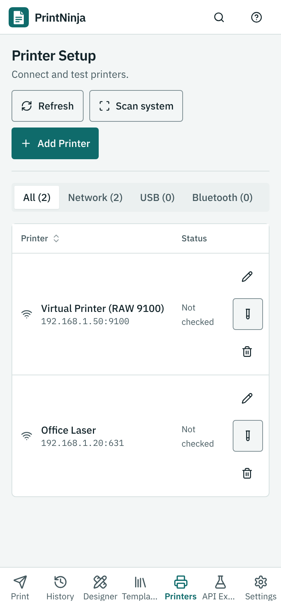 390px: actions stacked in three rows</td>
<td align="center">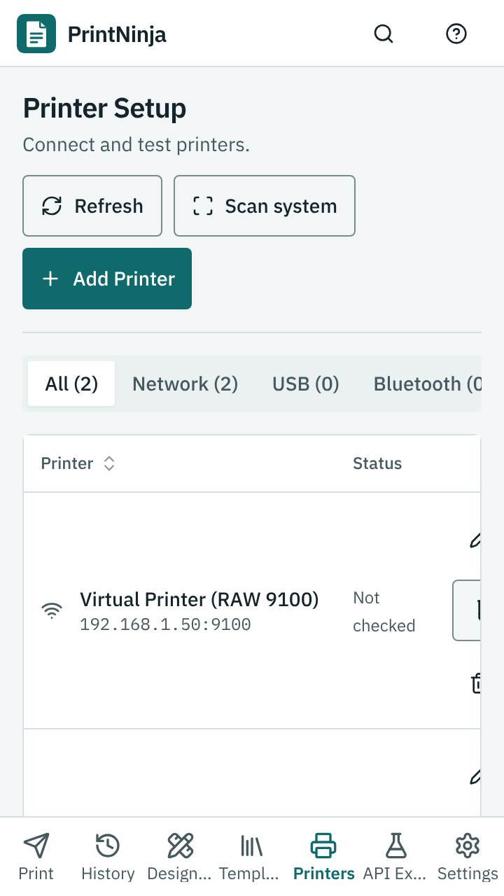 360px: actions clipped off-screen</td>
</tr>
</table>

**Problems**
- At 360px the table is 360px wide in a 326px wrapper (measured): the Test and Delete buttons are cut off and "Network" / "Bluetooth" filters run past the edge.
- At 390px the three icon buttons (edit, test print, delete) stack vertically in one cell, producing rows about 170px tall for a two-line printer, so only two printers fit on screen.
- Status reads "Not checked", wrapping onto two lines, and carries no color or icon.
- Delete sits within a thumb-width of Test print, with no distance between a harmless and a destructive action.

**Fixes**
- Same card pattern as Templates: name + address, status chip, a primary **Test print** button, and a ⋯ menu holding Edit and Delete (Delete confirms).
- Make the connection filters a horizontally scrollable chip row with a fade at the edge.
- Show connection status as an icon + word ("Not checked", "Online", "Error").

### 5. History (`/history`)

<table>
<tr>
<td align="center">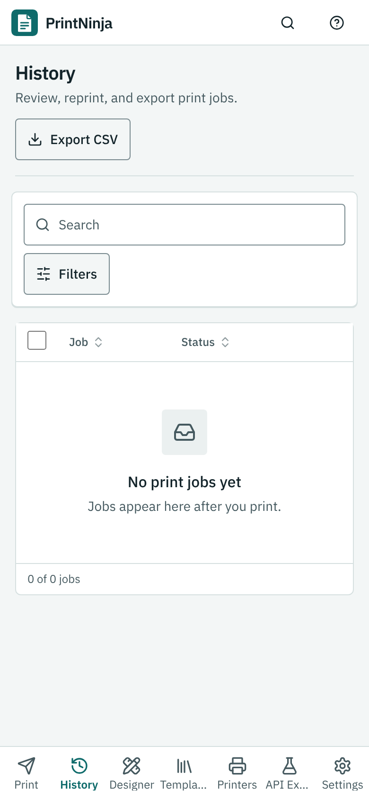 Empty state</td>
<td align="center">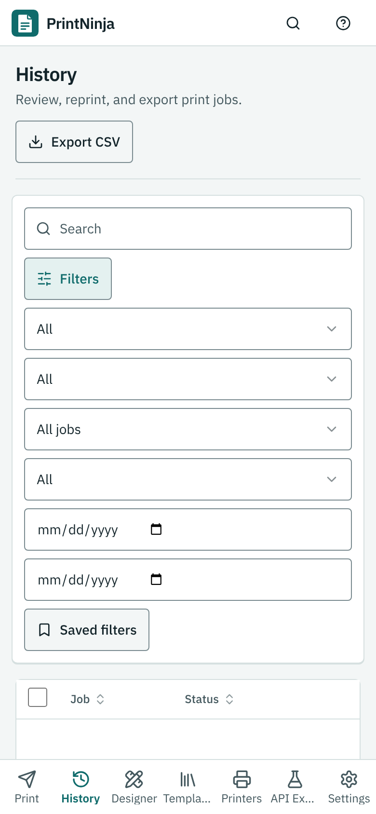 Filters open: 6 controls, no labels</td>
</tr>
</table>

**Problems**
- Opening **Filters** expands six full-width controls (four selects and two date pickers) inline, about 480px tall, and the results are pushed below the fold.
- The selects show only their current value ("All", "All", "All jobs", "All") with **no visible label**, so you cannot tell which is status, printer, template or source.
- Two date pickers appear with no "From"/"To" label.
- With real data the table will have the same width problem as Templates (Job + Status only fit).

**Fixes**
- Put filters in a **bottom sheet** with labeled fields, an "Apply" and "Reset" footer, and show active filters as removable chips under the search box.
- Use the card layout for rows; keep the checkbox for multi-select, and show a sticky "Reprint (n)" bar when something is selected.
- Keep "Export CSV" in the page header, but move it into a ⋯ menu if the header gets crowded.

### 6. Settings (`/settings`)

<table>
<tr>
<td align="center">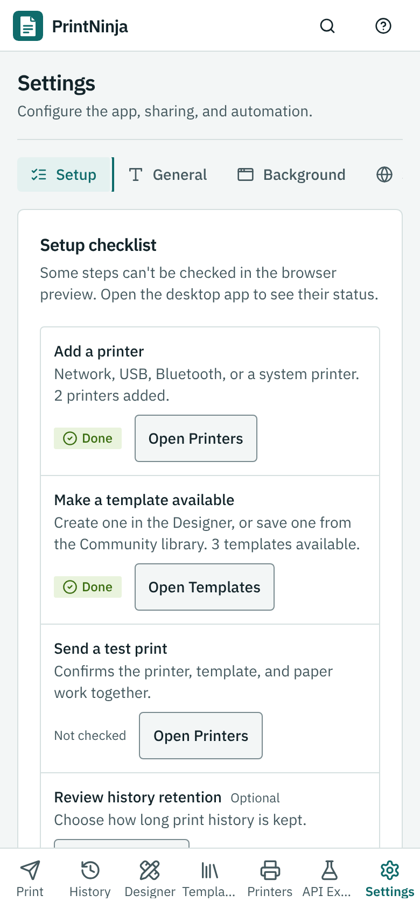 Setup tab; strip clips at the globe icon</td>
<td align="center">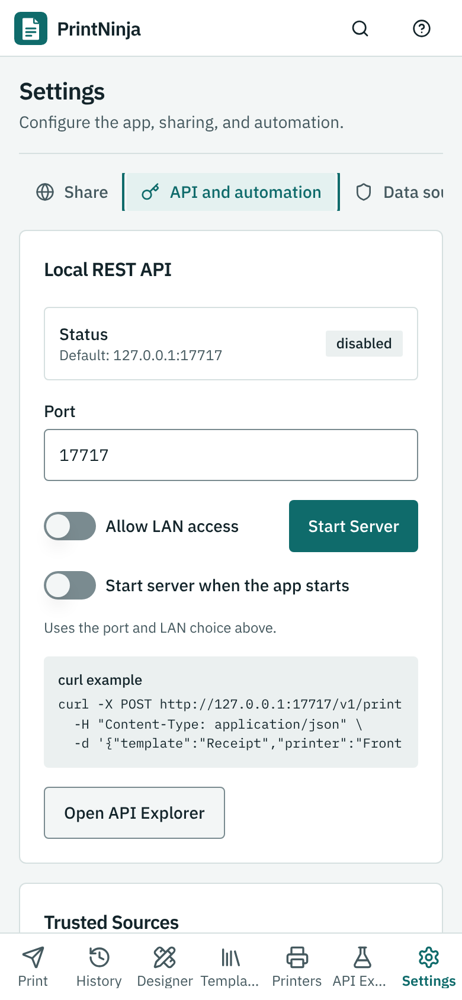 API tab; strip clips "Data sou…"</td>
<td align="center">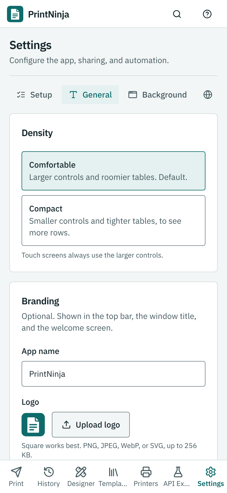 General tab</td>
</tr>
</table>

**Problems**
- Eight tabs (Setup, General, Background, Share, API and automation, Data sources, Retention, Diagnostics) make a **962px strip in a 358px box** (measured). The right edge is cut mid-word with no gradient or arrow, so people won't know there are more.
- The strip is `overflow-x-auto` (`Settings.tsx:479–482`), so it technically works by swiping, but it is easy to miss and the active tab can end up off-screen.
- Code samples (the `curl` example) are clipped at the card edge.

**Fixes**
- On phones, turn Settings into a **list → detail** flow: a list of sections with icons and one-line summaries; tapping one opens it with a back arrow. This is the standard pattern and removes the strip altogether.
- Cheaper alternative: keep the strip but scroll the active tab into view and add an edge fade.
- Wrap code samples (`white-space: pre-wrap`) or give them their own horizontal scroll with a visible scrollbar.

### 7. API explorer (`/api-explorer`)

<table>
<tr>
<td align="center">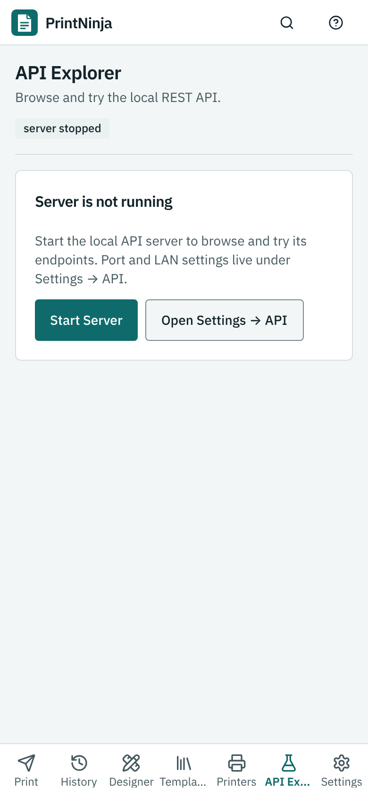 "Server is not running" state</td>
</tr>
</table>

Fine in this state. I could not check the running state (it needs the Tauri-hosted local server), which is likely a split request/response view and the most likely place for a layout problem. Re-check on a real device. This is a developer tool; a phone-friendly read-only mode is enough.

---

## Cross-cutting fixes

### Bottom navigation (`Layout.tsx:404–430`, `lib/shell/nav.ts`)

<table>
<tr>
<td align="center">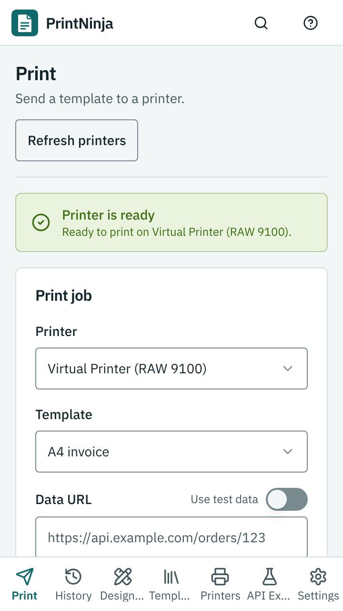 360px: "Design…", "Templ…", "API Ex…"</td>
<td align="center">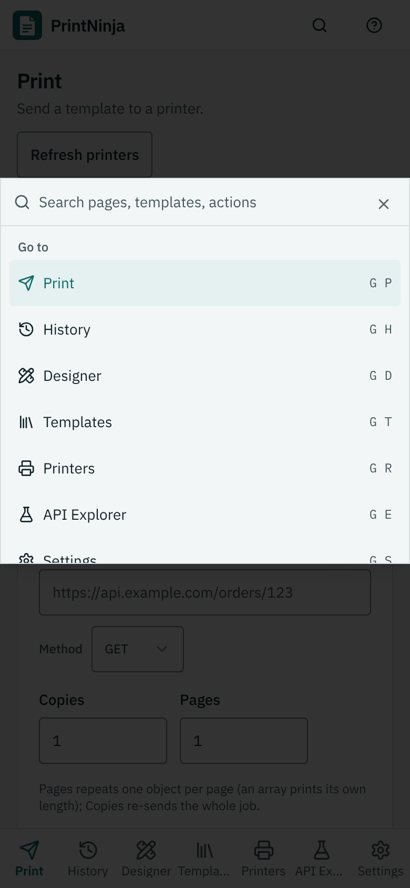 Command palette lists the same destinations</td>
</tr>
</table>

- Seven equal-width items at 390px leave about 55px each; labels truncate to "Templa…" and "API Ex…" (and "Design…" at 360px).
- **Fix:** show five items (**Print, History, Templates, Printers, More**). "More" opens a sheet with Designer, API Explorer and Settings. Alternatively drop labels on the less-used items. The command palette already works as an overflow.

### Touch targets

The shared `Button` has a coarse-pointer rule, but several other controls do not. Measured at 390px:

| Element | Measured | Where |
|---|---|---|
| `TabsTrigger` (Mine / Saved / Community; All / Network / USB …) | 32 px high | `ui/tabs.tsx:31` |
| Designer view tabs | 28–32 px high, `text-xs` | `Designer.tsx:963–976` |
| Column sort buttons | 36 px high, 38–70 px wide | `DataTable.tsx` |
| Header logo link | 28 px high | `Layout.tsx:257–262` |

**Fix:** add `[@media(pointer:coarse)]:min-h-11` to `TabsTrigger` and the sort buttons, and pad the logo link. Note: the select-all checkbox is only 20×20 but sits in a larger label (`CHECK_HIT`), so it is probably fine.

### Header status (`Layout.tsx:280`)

<table>
<tr>
<td align="center">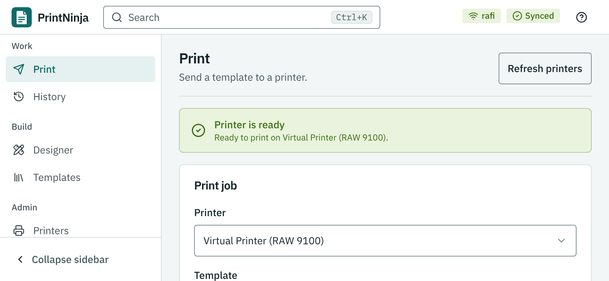 Landscape 844px: user + "Synced" chips appear</td>
</tr>
</table>

- `ShareIndicator` is `hidden sm:block`, so on a portrait phone you never see "Synced", "Offline" or the signed-in handle, although offline behaviour is a core feature of this app.
- **Fix:** show a compact dot (green / amber / red) in the header at all widths, with the label only from `sm`. Tapping it opens the same popover.

### Landscape phones (`Layout.tsx:310`)

<table>
<tr>
<td align="center">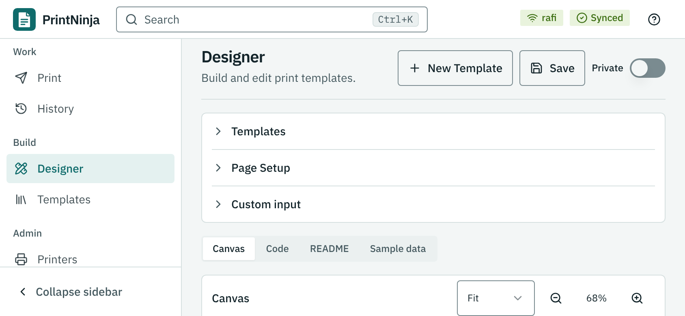 844×390: desktop sidebar, 224px wide, Printers already cut off</td>
</tr>
</table>

- At 844px wide the layout is the desktop one (`md:` ≥ 768px): a 224px sidebar takes about a quarter of the width, the full search bar takes the header, and the sidebar needs its own scrolling to reach Printers/Settings, all inside a 342px-tall content area.
- **Fix:** key the shell on input and height as well as width, e.g. use the bottom/side rail when `(pointer: coarse) and (max-height: 500px)`, start the sidebar collapsed to its icon rail, and hide the wide search field.

### Viewport, safe areas and dynamic viewport height

- `index.html` has `width=device-width, initial-scale=1.0` but no `viewport-fit=cover`. The code uses `env(safe-area-inset-top/bottom)` (`Layout.tsx:256,406`), which resolves to 0 without it, so notches, gesture bars and edge-to-edge Android can overlap the header and bottom nav. **Fix:** add `viewport-fit=cover`, then verify on device.
- `Layout.tsx:246` uses `h-screen` (`100vh`) and several screens use `min-h-screen` (`SignInScreen`, `Onboarding`, `ServerUnreachableScreen`, `AuthGate`, `App`). On mobile browsers with a collapsing URL bar the bottom nav can sit under the browser chrome. **Fix:** use `h-dvh` / `min-h-dvh`, with `100vh` as the fallback.
- Inputs use `text-sm` (14px). iOS Safari auto-zooms into any focused field under 16px. This only matters if the web build is used in mobile Safari; the Tauri Android WebView does not do this. **Fix (web only):** `text-base` on coarse pointers.

### Pointer-only affordances

- The command palette shows keyboard hints (`G P`, `G H`, …) and the help dialog lists shortcuts. These are meaningless on touch. **Fix:** hide `kbd` hints on `pointer: coarse`.
- Hover-only controls should be checked on a device (the audit could not hover).

---

## Suggested order of work

**Phase 1: quick wins (about 2–3 days)**
1. `viewport-fit=cover` and `dvh` units.
2. Tab and sort-button tap targets.
3. Sticky Print bar; collapse Data URL fields by default.
4. Labeled History filters in a sheet.
5. Compact sync status dot at all widths.
6. Bottom nav → five slots (Print, History, Templates, Printers, More).

**Phase 2: tables to cards (about 3–4 days)**
7. A shared `ResponsiveList` / card mode in `DataTable.tsx`, switched on below `md`.
8. Adopt it in Printers, Templates, History; move row actions into a ⋯ menu.

**Phase 3: Designer and Settings (about 1–2 weeks, depends on scope decision)**
9. Designer: sticky view tabs, controls in a bottom sheet, pinch-zoom canvas, wrapped code editor.
10. Settings: list → detail on phones.
11. Landscape shell behaviour.

**Phase 4: verify**
12. Re-run this audit (below) and test on a real Android device and the Android emulator.

## Make it stick: automated checks

The repo already has Playwright (`e2e/`), `axe-core`, and a fake agent, so the checks above can run in CI:

- Add a **`mobile` Playwright project** using `devices['Pixel 7']` and a 360×640 variant, running a small smoke spec over every route.
- In that spec assert `document.documentElement.scrollWidth <= innerWidth`, and that no visible `button`, `a`, `[role=tab]` on the page is smaller than 44×44 (with an allow-list for known exceptions).
- Add one **screenshot test per route** at 390×844 so layout regressions show up in review.
- Run the existing `axe-core` pass at the phone viewport for contrast and label problems (the unlabeled History selects would be caught here).

The two scripts used for this audit are small enough to start from: they seed the fake agent, stub `/v2`, and iterate over routes.

## Open questions (they change the plan)

1. **Who uses the phone?** Operators printing labels from a phone (Print, History, Printers) or also template authors (Designer)? If the former, skip Phase 3's Designer rework and ship a view-only/tweak mode.
2. **Which runtime matters?** The Android Tauri app, or the web build on a phone browser? Safe areas, the soft keyboard and `100dvh` behave differently in each.
3. **Is Android landscape a supported orientation** (for example for a docked scanner/tablet)? If not, lock to portrait and drop that item.
4. **Is there a minimum supported width?** 360px is the common Android floor; the audit shows several screens already break at 360.

## Files in this folder

- `PLAN.md`: this document
- `shots/`: all screenshots (390×844 unless the caption says otherwise), plus `audit.json` and `notes.json`
